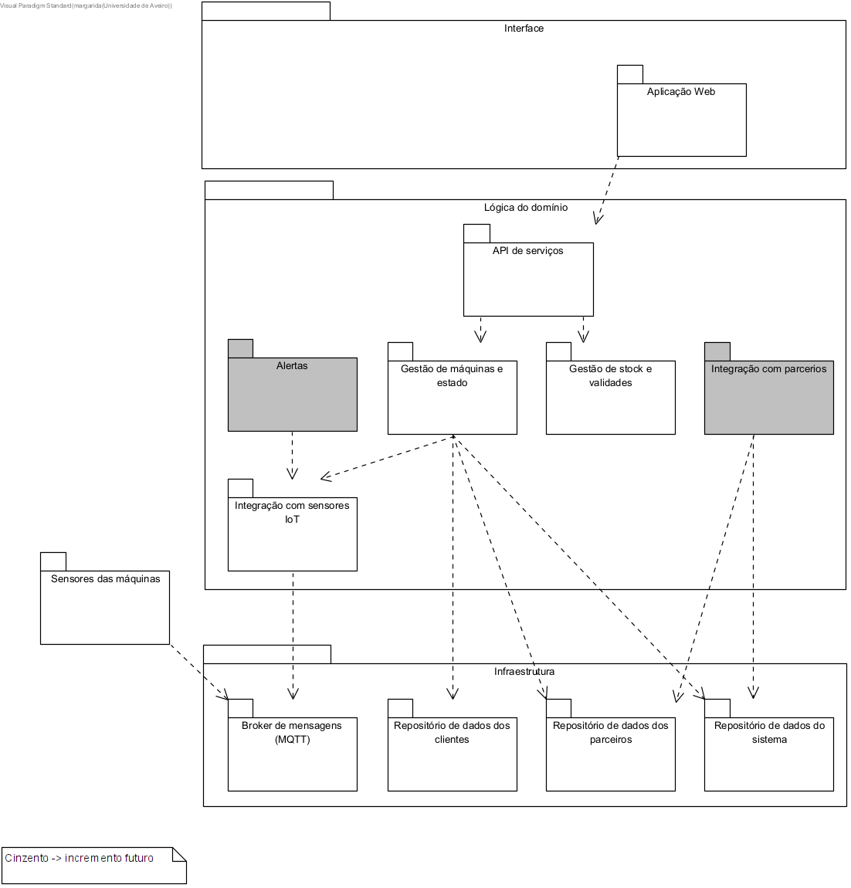
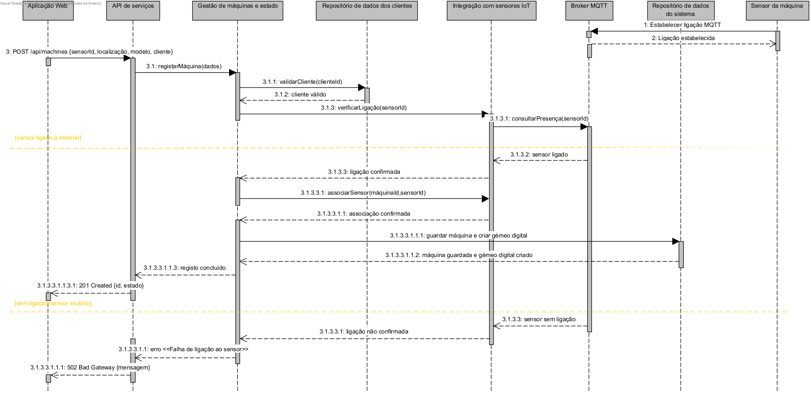
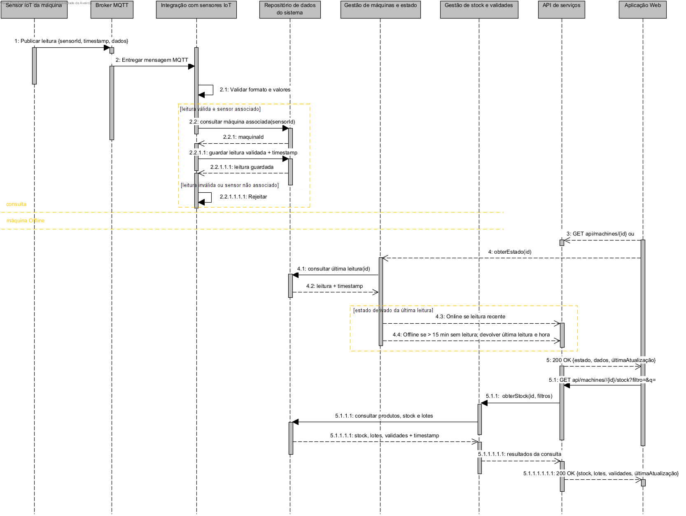

| **Projeto:**     | DPVending - God’s Eye                                                                                                                                                                                                                                                                                                                                                                                                                      |
|------------------|--------------------------------------------------------------------------------------------------------------------------------------------------------------------------------------------------------------------------------------------------------------------------------------------------------------------------------------------------------------------------------------------------------------------------------------------|
| **Grupo:**       | Luís Oliveira \[125016\], Tomás Cardoso \[125050\], Margarida Teixeira \[126011\] , Jéssica Zheng \[126541\]                                                                                                                                                                                                                                                                                                                               |
| **Data/versão:** | 2026/11/25, v1.0                                                                                                                                                                                                                                                                                                                                                                                                                           |
| **Sumário:**     | O God’s Eye é uma aplicação web para a DPVending monitorizar máquinas de vending (estado, stock e validades por lote) a partir de sensores IoT. Este documento define a arquitetura em camadas, a integração MQTT, a separação lógica dos repositórios, as decisões de arquitetura, a API REST e o mapeamento dos slices do 1.º incremento. |

**Controlo de versões**

*Atualizar sempre que o documento sofrer alterações relevantes. Versões 0.x são drafts; 1.0 marca a baseline aprovada.*

| **Data**   | **Autor(es)**                                        | **Descrição da alteração**                                                                                  |
|------------|------------------------------------------------------|-------------------------------------------------------------------------------------------------------------|
| 2026/11/24 | Grupo (rascunho preenchido com apoio de AI; a rever) | v1.0 — Preenchimento do desenho: arquitetura, ADR, integração IoT, API de serviços e mapeamento dos slices. |
|            |                                                      |                                                                                                             |
|            |                                                      |                                                                                                             |

# Introdução

## Sumário executivo

Este relatório apresenta as principais decisões relativamente ao plano técnico para a construção do sistema GOD’S EYE.

O sistema terá uma aplicação web para gestão e monitorização das máquinas de vending da DPVending, incluindo a consulta do estado das máquinas, do stock e das validades.

O 1.º incremento (Épico \#1, representação digital de uma máquina) inclui quatro slices: registar a máquina e ativar o gémeo digital (UC-01.S1), consultar o estado (UC-02.S1), consultar o stock e as validades por lote (UC-03.S1) e filtrar e pesquisar o stock (UC-03.S2). A arquitetura é por camadas e integra os sensores através de MQTT (ADR-005), ficando a compatibilidade dos equipamentos e os detalhes das mensagens por confirmar. Os dados são organizados em repositórios lógicos separados por responsabilidade (ADR-006).

Os módulos de *frontend* integrarão com a lógica aplicacional através de uma interface de serviços (API REST), apresentada na secção 3 (ver ADR-001 e ADR-003).

## Como é que utilizamos os recursos de AI

O grupo conduz a implementação com o OpenSpec (esquema spec-driven). As skills do OpenSpec (explore, propose, update-change, apply-change, verify-change, sync-specs e archive-change) estão em .agents/skills, e cada slice do 1.º incremento tem uma change em openspec/changes: uc-01-s1-registar-maquina, uc-02-s1-consultar-estado, uc-03-s1-consultar-stock e uc-03-s2-filtrar-stock. \[CONFIRMAR: agente(s), modelo(s) e versão do OpenSpec usados pelo grupo.\] Este documento foi preenchido com apoio do Claude (Anthropic), a partir do repositório, da Visão, da SRS e das changes.

**Gerado pelo agente:** em cada change, proposal.md, design.md, specs/\<capability\>/spec.md e tasks.md, a partir dos slices da SRS. **Escrito pelo grupo:** a Visão (E2), os protótipos (E3), a SRS e os diagramas (E4), as decisões de arquitetura (ADR) e a revisão final deste E5. O código e os testes ainda não foram gerados: todas as tarefas de tasks.md estão por fazer.

**Revisão:** antes de aplicar uma change, o grupo confronta o design.md e as tarefas com as regras de negócio (BR), os RNF e os casos de teste (CT) da SRS. As tarefas já indicam os valores esperados dos CT: por exemplo, a 1.2 de UC-03.S1 verifica o CT-03.1 com 10 unidades de «Leite com Chocolate», a 2.1 de UC-03.S2 verifica o CT-03.2 com um lote expirado há um dia e a 1.2 de UC-01.S1 verifica a mensagem «Falha de ligação ao sensor» (CT-01.2). Os testes gerados têm de usar esses valores e o resultado esperado da SRS (ver ADR-002). A questão em aberto do S1 (limiar de «perto da validade») fica resolvida pela BR-05: 7 dias por defeito.

# Arquitetura do sistema

## Objetivos gerais

Os objetivos que mais condicionam a arquitetura do God’s Eye são os seguintes.

- Os gestores de operações devem poder consultar, através de uma aplicação web, o estado, o stock e as validades das máquinas de vending da DPVending.

- O sistema deve receber dados dos sensores IoT instalados nas máquinas para apoiar essa consulta. A disponibilidade e a atualidade dos dados dependem da ligação das máquinas à Internet e da integração com os sensores.

- A aplicação deve apresentar a hora da última atualização dos dados, para que os utilizadores consigam distinguir informação recente de informação desatualizada.

- Os técnicos de reposição e manutenção devem poder consultar as tarefas e as intervenções planeadas através da aplicação, respeitando as permissões associadas ao seu perfil.

- A arquitetura deve permitir testar a aplicação web automaticamente com Playwright.

- Uma máquina só é monitorizada depois de registada e com sensores associados (BR-01); se não houver ligação, o registo falha e não fica nenhum estado parcial.

- Os dados têm de aparecer em até 30 segundos (RNF-01) e as páginas principais carregar em até 3 segundos (RNF-02). Sem dados há mais de 15 minutos a máquina passa a Offline (BR-03) e a interface mostra os últimos dados com a hora (RNF-06).

- O sistema deve suportar pelo menos 1000 máquinas sem que os tempos de carregamento aumentem mais de 20% (RNF-10) e funcionar nas duas versões mais recentes de Chrome, Edge, Firefox e Safari (RNF-09).

- O acesso exige autenticação e respeita os perfis (RNF-07).

- A integração dos sensores está prevista através de MQTT (ADR-005). O suporte MQTT pelos equipamentos, o formato e a frequência das mensagens têm de ser confirmados antes da integração com sensores reais; o simulador do 1.º incremento publica no broker.

## Requisitos com impacto na arquitetura

*Tabela 1: Resumo dos requisitos não funcionais com impacto na arquitetura.*

| **Requisitos** | **Descrição**                                                                                                                                                                                   |
|----------------|-------------------------------------------------------------------------------------------------------------------------------------------------------------------------------------------------|
| RT-1           | A aplicação web deve permitir testes automáticos de ponta a ponta com Playwright: elementos interativos identificáveis por seletores estáveis e dados de teste repostos antes de cada execução. |
| RNF-01         | Os dados recebidos das máquinas devem aparecer no sistema em até 30 segundos.                                                                                                                   |
| RNF-02         | As páginas principais, incluindo o mapa, a lista de máquinas e os alertas, devem carregar em até 3 segundos.                                                                                    |
| RNF-04         | As funções destinadas aos técnicos devem poder ser utilizadas num telemóvel, sem necessidade de ampliar o ecrã.                                                                                 |
| RNF-05         | A plataforma deve estar disponível fora do horário de funcionamento da empresa.                                                                                                                 |
| RNF-06         | Quando uma máquina estiver offline, o sistema deve indicar esse estado e a hora da última atualização, em vez de apresentar os últimos dados como atuais.                                       |
| RNF-07         | O acesso deve exigir autenticação, respeitar as permissões dos perfis e impedir o acesso de um cliente aos dados de outra entidade.                                                             |
| RNF-09         | A aplicação deve funcionar nas duas versões mais recentes de Chrome, Edge, Firefox e Safari.                                                                                                    |
| RNF-10         | O sistema deve suportar pelo menos 1000 máquinas sem que os tempos de carregamento definidos no RNF-02 aumentem mais de 20%.                                                                    |
| RNF-11         | A interface deve apresentar os textos no idioma do utilizador. Isto pode exigir que os textos da interface sejam organizados de forma a suportar a tradução.                                    |
| RNF-12         | A informação partilhada deve poder ser integrada nos sistemas dos parceiros segundo a norma EVA-DTS; a SRS define como objetivo que 95% dos pedidos estejam disponíveis em até 5 minutos.       |

Como estes requisitos influenciam as escolhas:

- RNF-01, RNF-02 e RNF-06: cada leitura é guardada com a hora de origem e o estado é calculado na consulta (ADR-004); a lista de máquinas é paginada e indexada pela última leitura.

- RNF-10: o acesso por máquina (/api/machines/{id}) evita carregar toda a rede de cada vez.

- RNF-07: autenticação e perfis na API, não na interface.

- RT-1, RNF-04, RNF-09 e RNF-11: aplicação web responsiva, com seletores data-testid estáveis, textos fora do código e dados de teste repostos antes de cada execução (ADR-002).

- RNF-05 e RNF-12: disponibilidade fora do horário de expediente e integração com parceiros (EVA-DTS) ficam como requisitos de implantação e de incrementos futuros.

## Vista geral da arquitetura

*Figura 1: Vista lógica da arquitetura (diagrama de pacotes). A cinzento: módulos de incrementos futuros.*

A articulação entre os módulos decorre da seguinte forma:

A Aplicação Web (camada de interface) comunica apenas com a API de serviços, que encaminha os pedidos para os módulos do domínio.

- **Gestão de máquinas e estado:** regista máquinas, associa sensores, cria o gémeo digital e calcula o estado (Online, Com alerta, Offline) a partir da última leitura. Consulta o Repositório de dados dos clientes para validar o cliente associado e o Repositório de dados do sistema para guardar e consultar máquinas, associações a sensores e leituras.

- **Gestão de stock e validades:** consulta no Repositório de dados do sistema o stock por produto e lote e aplica os estados de stock (BR-04) e de validade (BR-05), os filtros e a pesquisa por nome.

- **Integração com sensores IoT:** subscreve as leituras encaminhadas pelo Broker MQTT, valida-as, associa-as à máquina e guarda-as com a hora de origem no Repositório de dados do sistema; é a fronteira entre o sistema e os sensores.

- **Broker MQTT:** recebe as mensagens publicadas pelos sensores e disponibiliza-as à Integração com sensores IoT, desacoplando os sensores dos módulos do domínio.
- **Repositório de dados dos clientes:** guarda os dados necessários para validar o cliente associado a uma máquina.
- **Repositório de dados do sistema:** guarda máquinas, associações a sensores, leituras, produtos, stock e lotes.
- **Repositório de dados dos parceiros:** reservado aos dados da futura integração com parceiros.

Entram no 1.º incremento a Aplicação Web, a API de serviços, a Gestão de máquinas e estado, a Gestão de stock e validades, a Integração com sensores IoT, o Broker MQTT e os repositórios de dados dos clientes e do sistema. Ficam para incrementos futuros os módulos a cinzento: Alertas (Épico \#3), Integração com parceiros e o Repositório de dados dos parceiros. Enquanto não existir o módulo de Alertas, a classificação «Com alerta» não tem alertas ativos para ler e uma máquina com dados recentes aparece como Online.

## Integração de sistemas e dispositivos

O God’s Eye deverá receber dados dos sensores IoT associados às máquinas de vending. Esses dados poderão incluir o estado operacional, a temperatura, o stock e as validades por lote, desde que os sensores e os sistemas de cada máquina disponibilizem essa informação.

A integração será feita através do módulo de integração IoT representado na vista da arquitetura. Quando receber dados, o sistema deverá associá-los à máquina correspondente e guardar a hora da leitura, para que os utilizadores possam distinguir dados recentes de dados desatualizados. Se uma máquina deixar de enviar dados, o sistema deverá apresentar a última leitura recebida com a respetiva hora e indicar que a máquina está offline, conforme definido na SRS.

O protocolo definido para a integração é MQTT, através do Broker MQTT (ADR-005). A compatibilidade dos sensores reais com MQTT, o formato e a frequência das mensagens e o processo de instalação e identificação dos sensores ainda têm de ser confirmados. Por isso, este desenho não assume que os sensores já fornecem todos os dados necessários.

A partilha de necessidades de reposição com fornecedores e transportadoras está prevista para um incremento posterior. O formato dos dados e a forma de comunicação com cada parceiro terão de ser definidos com base nos sistemas e acordos disponíveis.

Os diagramas seguintes mostram as interações do 1.º incremento com os sensores através do broker. No 1.º incremento, um simulador publica as leituras no mesmo broker que será utilizado pela integração. O conteúdo da mensagem é provisório e será confirmado face às capacidades dos equipamentos, incluindo identificação do sensor, hora da leitura, temperatura, estado operacional, stock e lotes.

*Figura 2: Diagrama de sequência do registo de uma máquina (UC-01.S1).*

No registo, a máquina só é guardada e o gémeo digital só é criado depois de a ligação ser verificada e o sensor ser associado (BR-01). Sem ligação, o fluxo termina com a mensagem «Falha de ligação ao sensor» e nada é guardado (CT-01.2).

*Figura 3: Diagrama de sequência da receção de leituras IoT e da consulta do estado e do stock (UC-02.S1, UC-03.S1 e UC-03.S2).*

Cada leitura é guardada com a hora de origem. O estado (Online, Com alerta, Offline) não é guardado: calcula-se na consulta, a partir da hora da última leitura e dos alertas ativos, com prioridade para Offline (mais de 15 minutos sem dados, BR-03). Em Offline, a API devolve os últimos dados com a hora da última atualização, assinalados como não atuais (RNF-06).

As leituras IoT não fazem parte da API REST de serviços: são publicadas pelo sensor ou simulador no broker MQTT e consumidas pelo módulo de Integração com sensores IoT. A validação e persistência da mensagem ocorrem nesse módulo; o formato final, a autenticação dos dispositivos e o mecanismo de presença do sensor carecem de confirmação antes da implementação com equipamentos reais.

## Decisões de arquitetura (ADR)

*Tabela 2: Decisões de arquitetura.*

| **ADR** | **Decisão**                                                                                                                                                                                                                                                | **Alternativas consideradas**                                                                                                                                                         | **Consequências**                                                                                                                                                                                     |
|---------|------------------------------------------------------------------------------------------------------------------------------------------------------------------------------------------------------------------------------------------------------------|---------------------------------------------------------------------------------------------------------------------------------------------------------------------------------------|-------------------------------------------------------------------------------------------------------------------------------------------------------------------------------------------------------|
| ADR-001 | Frontend: React + TypeScript (Vite). Backend: Node.js + TypeScript (Fastify), API REST. Base de dados: PostgreSQL. Testes E2E: Playwright.                                                                                                                 | Next.js full-stack (chamadas diretas, sem API separada): afastado porque a API deve servir outros frontends e parceiros. Java/Spring Boot com páginas no servidor. SQLite ou MongoDB. | Uma só linguagem nas duas camadas e Playwright nativo em TypeScript. PostgreSQL trata bem consultas por lote e validade e a escala de 1000 máquinas. Custa manter dois projetos (frontend e backend). |
| ADR-002 | Estratégia de teste: testes unitários (Vitest) das regras BR-02 a BR-05; testes de API (Supertest, BD de teste); testes E2E com Playwright por slice, com os valores dos CT da SRS. BD reposta antes de cada execução; tudo corre na pipeline a cada push. | Só testes E2E. Só testes unitários. Testes manuais.                                                                                                                                   | Cada CT tem pelo menos um teste automático com os valores e o resultado esperado da SRS. A pipeline demora mais; exige seletores \`data-testid\` estáveis e dados de teste (seed).                    |
| ADR-003 | API REST em JSON com contrato OpenAPI em docs/api/openapi.yaml. Não há endpoints fora do contrato.                                                                                                                                                         | GraphQL. RPC. Chamadas diretas da interface à lógica.                                                                                                                                 | Vários frontends e parceiros reutilizam a mesma API; o contrato serve de base aos testes de API. Exige manter o contrato atualizado.                                                                  |
| ADR-004 | O estado da máquina é calculado na consulta: Offline se passaram mais de 15 minutos desde a última leitura (prioridade sobre Com alerta); cada leitura guarda a hora de origem.                                                                            | Guardar o estado e atualizá-lo por tarefa periódica.                                                                                                                                  | Evita mostrar um estado desatualizado e cumpre RNF-06. Cada consulta faz um pequeno cálculo, atenuado por índice na última leitura da máquina.                                                        |
| ADR-005 | Os sensores publicam as leituras num broker MQTT; o módulo de Integração com sensores IoT subscreve os tópicos. O simulador do 1.º incremento publica no mesmo broker.                                                                                         | Envio direto por HTTP para a API; fila AMQP ou Kafka; consulta periódica aos sensores.                                                                                                  | Desacopla sensores e aplicação, mas acrescenta um componente a operar e exige confirmar suporte MQTT e autenticação nos sensores reais.                                                           |
| ADR-006 | Separar logicamente os dados dos clientes, do sistema e dos parceiros. No 1.º incremento usam-se os repositórios de clientes e do sistema; o de parceiros fica para o futuro. A localização física ainda está por definir.                                  | Um único repositório; repositórios lógicos separados por responsabilidade.                                                                                                               | Clarifica responsabilidades e acessos, com maior complexidade de configuração e manutenção. Não implica, por si só, servidores ou tecnologias distintos.                                        |

## Alinhamento com processo (OpenSpec)

O desenho chega ao agente pelo `openspec/config.yaml`, que fornece o contexto de arquitetura e as regras para os artefactos. O excerto abaixo resume as entradas relevantes do ficheiro atual:

context: \|

Arquitetura: docs/design/E5-Desenho.md. Camadas: Interface, Lógica do domínio, Infraestrutura.

Módulos: Aplicação Web, API de serviços, Gestão de máquinas e estado, Gestão de stock e validades,

Integração com sensores IoT, Broker MQTT, Repositório de dados dos clientes e Repositório de dados do sistema;
futuros: Alertas, Integração com parceiros e Repositório de dados dos parceiros.

Decisões: docs/adr/ (ADR-001 stack; ADR-004 estado derivado; ADR-005 broker MQTT; ADR-006 separação lógica dos repositórios).

Contrato da API: docs/api/openapi.yaml. Não criar endpoints fora do contrato.

Integração IoT através de MQTT (ADR-005); simulador do 1.º incremento publica no broker.
Leituras IoT não são recebidas pela API REST. Repositórios separados logicamente (ADR-006), com concretização física por confirmar.

rules:

design:

\- Indicar os módulos (E5 2.3) e os endpoints afetados.

\- Referir os ADR aplicáveis; um desvio à arquitetura exige um ADR novo.

tasks:

\- Cada scenario tem uma tarefa de teste.

\- O nome de cada teste começa pelo ID do caso de teste (CT-nn.k).

\- Os testes do slice passam antes do arquivo.

**No E5 fica** o que vale para todo o produto: vista lógica, ADR, contrato da API e mapeamento slice → módulos. **No \`design.md\` de cada change fica** o fluxo e as decisões locais do slice (ordem dos passos, regras aplicadas, riscos), que referem os módulos e os endpoints da Tabela 4 sem os redefinir. As specs descrevem apenas comportamento observável, com origem na SRS (BR, RNF e CT); o que pode mudar sem alterar o comportamento visível (módulos, endpoints, tecnologia) pertence ao desenho. Uma decisão que contrarie um ADR exige um ADR novo.

# Interface de serviços

A interface de serviços é uma API REST em JSON que separa a Aplicação Web da lógica do domínio (ADR-003). Serve este frontend e pode servir outros e, mais tarde, parceiros. O contrato completo está em docs/api/openapi.yaml; a Tabela 3 resume os endpoints do 1.º incremento. Todos os pedidos de utilizadores exigem autenticação e perfil adequado (RNF-07).

## API de serviços

*Tabela 3: Contrato da API de serviços de acesso ao backend.*

| **Coleção (recurso)** | **Ponto de acesso (method + *path*)**                                             | **Funcionalidade/mensagem**                                                                                                                                                     |
|-----------------------|-----------------------------------------------------------------------------------|---------------------------------------------------------------------------------------------------------------------------------------------------------------------------------|
| machines              | POST /api/machines                                                                | Registar uma máquina (sensorId, localização, modelo, cliente), associar o sensor e criar o gémeo digital. 201 em caso de sucesso; 502 «Falha de ligação ao sensor» sem ligação. |
| machines              | GET /api/machines                                                                 | Listar as máquinas com estado e hora da última atualização (lista e mapa); filtro opcional ?estado=online\|alerta\|offline.                                                     |
| machines              | GET /api/machines/{id}                                                            | Estado de uma máquina: classificação, temperatura, dados operacionais e hora da última leitura.                                                                                 |
| stock                 | GET /api/machines/{id}/stock                                                      | Stock por produto (unidades, capacidade, mínimo, estado) com os lotes (validade e dias restantes).                                                                              |
| stock                 | GET /api/machines/{id}/stock?filtro=stock-baixo\|perto-validade\|expirado&q=leite | Filtrar por estado e pesquisar por nome do produto; os dois combinam-se. Com a máquina Offline devolve o último stock conhecido e a hora da última atualização.                 |

 

## Mapeamento dos slices para a API e os módulos

*Tabela 4: Mapeamento slice → endpoint (se aplicável) → módulo.*

| **Slice**                               | **Endpoint(s) (se aplicável)**            | **Módulo(s)**                                                                                                  |
|-----------------------------------------|-------------------------------------------|----------------------------------------------------------------------------------------------------------------|
| UC-01.S1                                | POST /api/machines                        | Aplicação Web; API de serviços; Gestão de máquinas e estado; Repositório de dados dos clientes; Repositório de dados do sistema; Integração com sensores IoT; Broker MQTT |
| UC-02.S1                                | GET /api/machines; GET /api/machines/{id} | Aplicação Web; API de serviços; Gestão de máquinas e estado; Repositório de dados do sistema                   |
| UC-03.S1                                | GET /api/machines/{id}/stock              | Aplicação Web; API de serviços; Gestão de stock e validades; Repositório de dados do sistema                  |
| UC-03.S2                                | GET /api/machines/{id}/stock?filtro=&q=   | Aplicação Web; API de serviços; Gestão de stock e validades; Repositório de dados do sistema                  |
| Suporte (ingestão IoT)                   | MQTT (tópico definido no ADR-005)         | Sensor/simulador; Broker MQTT; Integração com sensores IoT; Repositório de dados do sistema                   |
